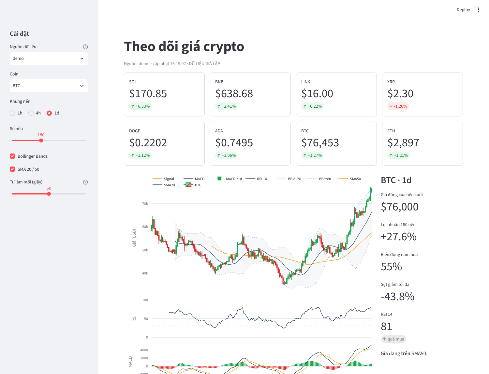

# Crypto Tracker: theo dõi giá crypto thời gian thực bằng Python

Hệ thống nhỏ gồm 3 phần: **thu thập giá** từ API miễn phí (CoinGecko hoặc sàn Binance qua `ccxt`), **lưu lịch sử** vào SQLite và **dashboard Streamlit** có biểu đồ nến, chỉ báo kỹ thuật và cảnh báo giá (in ra màn hình hoặc gửi Telegram).


*Ảnh chụp ở chế độ `demo` (dữ liệu giả lập). Khi chọn CoinGecko hoặc Binance, số liệu là giá thật.*

## 1. Cài đặt và chạy

```bash
pip install -r requirements.txt

streamlit run app.py                     # mở http://localhost:8501
python collector.py --source coingecko   # (terminal khác) thu thập mỗi 60 giây + kiểm tra cảnh báo
pytest -q                                # 8 test, không cần mạng
```

Chạy thử không cần mạng: `TRACKER_SOURCE=demo streamlit run app.py` và `python collector.py --source demo --every 2 --iterations 5`.

## 2. Kiến trúc

```
CoinGecko API ─┐                       ┌─> app.py (Streamlit): bảng giá, nến, SMA, Bollinger, RSI, MACD
Binance (ccxt) ┼─> tracker/sources.py ─┤
Demo (giả lập) ┘   (cùng 1 định dạng)  └─> collector.py ─> SQLite (ticks, alerts) ─> tracker/alerts.py ─> màn hình / Telegram
```

| File | Việc làm |
|---|---|
| `tracker/sources.py` | 3 nguồn dữ liệu trả về cùng dạng bảng: `tickers()` (giá, % 24h, volume) và `ohlcv()` (nến). Đổi nguồn không phải sửa phần còn lại |
| `tracker/indicators.py` | SMA, EMA, RSI (cách làm mượt Wilder như TradingView), MACD, Bollinger, biến động năm hoá, sụt giảm tối đa. Viết bằng pandas nên không cần cài TA-Lib |
| `tracker/storage.py` | SQLite: bảng `ticks` (khóa chính thời điểm + coin + nguồn để không ghi trùng) và `alerts` |
| `tracker/alerts.py` | Luật cảnh báo: vượt ngưỡng giá, biến động X% trong N phút, RSI quá mua/quá bán; có thời gian chờ để không báo lặp |
| `collector.py` | Vòng lặp lấy giá, lưu, kiểm tra cảnh báo; lỗi mạng thì bỏ qua và thử lại lượt sau |
| `app.py` | Dashboard, tự làm mới bằng `st.fragment(run_every=...)`, cache để không gọi API quá nhiều |
| `rules.json` | Danh sách luật cảnh báo, sửa không cần đụng code |

## 3. Cấu hình

| Biến môi trường | Mặc định | Ý nghĩa |
|---|---|---|
| `TRACKER_SOURCE` | `coingecko` | nguồn mặc định của dashboard |
| `TRACKER_EXCHANGE` | `binance` | sàn dùng qua ccxt (`okx`, `kraken`, `bybit`...) |
| `COINGECKO_API_KEY` | trống | key gói Demo miễn phí, giúp ít bị giới hạn lượt gọi |
| `POLL_SECONDS` | `60` | chu kỳ thu thập |
| `TELEGRAM_TOKEN`, `TELEGRAM_CHAT_ID` | trống | bật gửi cảnh báo qua bot Telegram |
| `TRACKER_DB` | `crypto.db` | file SQLite |

Danh sách coin nằm trong `tracker/config.py` (`COINS`: mã → id CoinGecko, cặp trên sàn).

## 4. Lưu ý khi dùng API miễn phí

- CoinGecko gói miễn phí giới hạn khoảng 30 lượt gọi/phút; dashboard cache giá 55 giây và nến 5 phút để không vượt.
- Binance chặn truy cập từ một số quốc gia (ví dụ Mỹ trả lỗi 451). Khi đó đặt `TRACKER_EXCHANGE=okx` hoặc dùng CoinGecko.
- Nến từ CoinGecko được gom từ chuỗi giá (`market_chart`), volume là volume 24h trượt nên chỉ gần đúng; cần nến chuẩn thì dùng nguồn sàn.
- Đây là công cụ theo dõi, không phải lời khuyên đầu tư. Chỉ báo kỹ thuật (RSI, MACD) chỉ mô tả giá quá khứ.

## 5. Hướng mở rộng

- Thay polling bằng WebSocket của sàn (`ccxt.pro` hoặc `websockets`) để cập nhật từng giây.
- Thêm dữ liệu on-chain (Etherscan, Glassnode) hoặc chỉ số Fear & Greed.
- Backtest luật cảnh báo trên dữ liệu lịch sử trước khi dùng (xem project phân tích thị trường đi kèm).
